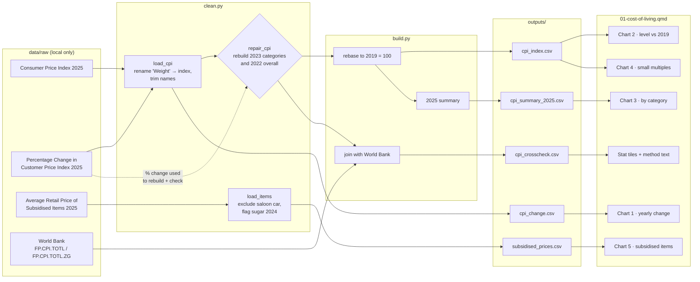

# 01 — Process record: Cost of living in 2025

How the data for this study was worked on, from download to published page, and why each
choice was made. Follows [docs/WORKFLOW.md](../../docs/WORKFLOW.md). Repo only, not on the site.

**Status:** published 15 Oct 2026 · **Last updated:** 16 Oct 2026 (written after publication
from the code and logs)

## Data lineage



## 1. Acquire

| Dataset | Owner (as listed) | Edition | File | Downloaded |
|---|---|---|---|---|
| Consumer Price Index 2025 | Department of Statistics, JPES | 2025 | `Consumer-Price-Index-2025.xlsx` | 15 Oct 2026 |
| Percentage Change in Customer Price Index 2025 | Department of Statistics, JPES | 2025 | `Percentage-Change-in-Consumer-Price-Index-2025.xlsx` | 15 Oct 2026 |
| Average Retail Price of Subsidised Items and under Price Control 2025 | Department of Statistics, JPES | 2025 | `Average-Retail-Price-of-Subsidised-Items-and-under-Price-Control-2025.xlsx` | 15 Oct 2026 |
| World Bank CPI and inflation (FP.CPI.TOTL, FP.CPI.TOTL.ZG) | World Bank WDI, original source IMF IFS | 2026 | `FP_CPI_TOTL.csv`, `FP_CPI_TOTL_ZG.csv` | 15 Oct 2026 |

Logged in `DATA_SOURCES.md`. Terms of Use reviewed 14 Oct 2026.

## 2. Inspect

- **Shape:** each data.gov.bn file is one sheet in long format: year, category, value.
- **Columns:** the CPI file heads its index column "Weight", but the values are index levels (around 100).
- **Coverage:** CPI 2015–2025 by category; % change 2016–2025; item prices 2015–2025.
- **Quirks:** mixed precision by year; "Health " has a trailing space; base year not stated
  (2015 overall = 99.9).
- **Known issues:** 6 for the CPI file and 2 for the item prices, in `DATA_SOURCES.md` → Known
  issues. The main ones: 2023 categories shifted one row down, a wrong 2022 overall value,
  sugar 2024 out of line, Laila rice → Local rice series break.

## 3. Clean

| # | Step | How (code) | Why |
|---|---|---|---|
| 1 | Name columns `year, category, value`; drop blank rows; trim category names | `clean.py:_read` | Same tidy shape for all three files; "Weight" was misleading and the trailing space broke joins |
| 2 | Rebuild 2023 categories as 2022 × (1 + published 2023 % change) | `clean.py:repair_cpi` | The published 2023 values are shifted by one category. The publisher's own % change table gives the true values to 2 decimals |
| 3 | Rebuild 2022 overall as 2021 × (1 + published 2022 % change) | `clean.py:repair_cpi` | The published 126.39 is the 2023 Miscellaneous value, from the same shift. Rebuilt value 106.48 agrees with the World Bank (106.33) |
| 4 | Mark rebuilt cells `repaired = True` | `clean.py:repair_cpi` | Readers and later steps can see which values were not published directly |
| 5 | Exclude "Saloon Car (1,500cc)" | `clean.py:ITEM_EXCLUDE` | Not a household staple and no data after 2019, so it can't be compared to 2025 |
| 6 | Flag sugar 2024 (BND 1.73) | `clean.py:ITEM_FLAGS` | 1.30 in 2022, 2023 and 2025 makes it doubtful. Flagged, not deleted, so the source value stays visible |
| 7 | Keep "Laila Rice" and "Local Rice" as separate items | `clean.py:load_items` (no merge) | Different item names with no overlap year. Joining them would create a series the source doesn't publish |

Values flagged rather than removed: sugar 2024; rebuilt CPI cells (`repaired`).

## 4. Validate

| Check | Rule | Result |
|---|---|---|
| Repair agrees with publisher | Implied % change vs published % change ≤ 0.25 pts, else the build stops | Pass: every year within 0.1 pts |
| CPI schema | year 2015–2025, index 50–200, one row per year × category | Pass |
| Items schema | price > 0, one row per year × item | Pass |
| Cross-check | Overall CPI vs World Bank FP.CPI.TOTL | Agrees after repair (e.g. 2022: 106.48 vs 106.33) |
| Unit tests | `tests/test_case01_clean.py`: synthetic shifted table is undone; repair refuses data that still disagrees | Pass (raw data isn't in CI, so the tests use small made-up tables) |

## 5. Process

| Output | Built from | Calculation | Why |
|---|---|---|---|
| `cpi_index.csv` | repaired CPI | `index_vs_base = index ÷ index(2019) × 100` | Source base year is unknown. 2019 is the last pre-pandemic year, so it's a clear reference point |
| `cpi_change.csv` | % change file | unchanged except trimmed names | Published figures shown as published |
| `cpi_summary_2025.csv` | % change + rebased CPI | 2025 change (published); change since 2019 = `index_vs_base(2025) − 100` | One table for the headline numbers and the category ranking |
| `subsidised_prices.csv` | item prices | none beyond cleaning | Chart 5 computes 2019 → 2025 change from it |
| `cpi_crosscheck.csv` | repaired overall CPI + World Bank | side-by-side join by year, values unaltered | Evidence that the repair is right; supports the method text |

Each CSV has a `.meta.json` with sources, retrieval dates and the change notes from `write_output`.

## 6. Visualise

| Chart | Output used | Chart type | Why this form |
|---|---|---|---|
| 1 · Yearly change 2016–2025 | `cpi_change` | Bars, pandemic years shaded | Yearly change is a separate amount per year, and bars show the sign (rise/fall) at a glance |
| 2 · Overall and food vs 2019 | `cpi_index` | Lines | A level over time; two lines answer "has food moved more than everything else?" |
| 3 · Change since 2019 by category | `cpi_summary_2025` | Horizontal bars, food highlighted, all items as reference | Ranking with long category names reads best horizontally |
| 4 · Every category over time | `cpi_index` | Small multiples, all items in grey behind each | Twelve lines on one chart would be unreadable; each panel compares one category with the total |
| 5 · Subsidised items 2019 → 2025 | `subsidised_prices` | Horizontal bars | Same ranking logic as chart 3, for items people buy |

Each builder in `figures.py` returns the figure and the table shown under it.

## 7. Post-process

- [x] Small counts: not applicable (national annual indices and prices)
- [x] Source + retrieval date on every chart; APA references in method
- [x] Disclaimer and AI-assistance byline
- [x] Neutral wording: periods named by time ("pandemic years and after"), not as causes
- [x] Data period on title and cards
- [ ] Translations: not enabled
- [x] Phone and desktop screenshots checked (open item: small label overlap on the phone category chart)
- [x] `uv run pytest` passes

## Decision log

| Date | Decision | Options considered | Reason |
|---|---|---|---|
| 14 Oct 2026 | Use data.gov.bn plus World Bank only | Other sources (IMF directly, BDCB…) | Approved sources only (policy §6) |
| 15 Oct 2026 | Repair the CPI shift instead of dropping 2022–2023 | Drop the years; use World Bank only; wait for a fix | The publisher's own % change table allows an exact rebuild, checked against the World Bank. Disclosed on the page |
| 15 Oct 2026 | Rebase to 2019 = 100 | Keep the source index; 2015 = 100 | Base year not stated; 2019 is the pre-pandemic reference |
| 15 Oct 2026 | Scope: when and what changed, not why | Explain causes | The data doesn't show causes; keeps the study neutral (SOP 8) |
| 15 Oct 2026 | World Bank (IMF-origin) series allowed for the cross-check | Leave out | CC BY 4.0 via World Bank, credited "original source: IMF IFS" |
| 15 Oct 2026 | Flag doubtful values instead of deleting them | Delete; correct by guess | Keeps the source visible; no correction without evidence |

## Reproduce

```sh
uv run python case_studies/01_cost_of_living/analysis/build.py
uv run quarto preview dashboard
```
