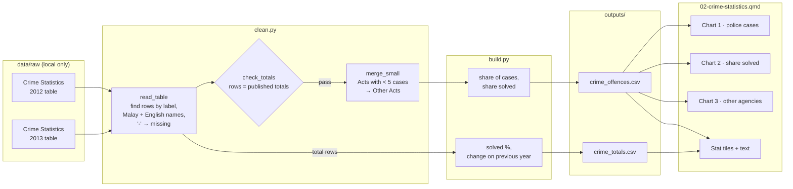

# 02 — Process record: Crime statistics

How the data for this study was worked on, from download to published page, and why each
choice was made. Follows [docs/WORKFLOW.md](../../docs/WORKFLOW.md). Repo only, not on the site.

**Status:** built 16 Oct 2026, not yet published (awaiting the author's push) · **Last updated:** 16 Oct 2026

## Data lineage



## 1. Acquire

| Dataset | Owner (as listed) | Edition | File | Downloaded |
|---|---|---|---|---|
| [Crime Statistics](https://www.data.gov.bn/crime-statistics-2/) | Royal Brunei Police Force | 2012 | `2-Crime-Statistics-2012.xlsx` | 16 Oct 2026 |
| [Crime Statistics](https://www.data.gov.bn/crime-statistics/) | Royal Brunei Police Force | 2013 | `3-Crime-Statistics-2013.xlsx` | 16 Oct 2026 |

Logged in `DATA_SOURCES.md`. Terms of Use re-checked on 16 Oct 2026 (unchanged in substance).
These are the only Royal Brunei Police Force crime tables in the catalogue.

## 2. Inspect

What the raw file looks like before anything is changed.

- **Shape:** one sheet per file, a printed yearbook table (14.2 for 2012, 14.3 for 2013). Two
  stacked tables: *cases handled by police* (4 offence groups) and *cases handled by other
  agencies* (one row per Act, 9 Acts in 2012 and 10 in 2013), each with a total row.
- **Columns:** nature of offence · total cases · solved (number and %) · arrests (persons).
  Headers span two merged rows.
- **Bilingual:** each row is a Malay label, then the English label on the next row with
  no values. These give official Malay terms for free, which is useful for translation later.
- **Coverage:** national, annual, 2012 and 2013 only. No districts, months or offence detail
  inside the four police groups.
- **Formulas:** totals and % are live Excel formulas. Their stored values match the row sums
  exactly (police 5,037 cases in 2012, 5,503 in 2013; other agencies 852 and 939).
- **Quirks:** "-" in some cells; stray blank-label rows; trailing spaces; one % typed by hand
  (Drugs 2012: 99.65, which matches 282 ÷ 283).
- **Known issues:** 6, in `DATA_SOURCES.md` → "Crime Statistics, 2012 and 2013 files". The main
  ones: only two years, "-" meaning unclear, the Acts listed change between years, and very
  small counts (1–3) for some Acts.

## 3. Clean

| # | Step | How (code) | Why |
|---|---|---|---|
| 1 | Read the stored values of each cell, not the formulas | `clean.py:read_table` (`data_only=True`) | Totals and % are Excel formulas. Stored values are what the publisher saw |
| 2 | Take the year from the table title ("Crime Statistics, 2012") | `clean.py:read_table` | The year isn't a column. Reading it from the title works for any edition |
| 3 | Find sections and rows by their labels, not row numbers | `clean.py:read_table` | The list of Acts differs by year (9 vs 10 rows). Fixed positions would break on another edition |
| 4 | Keep the Malay label (`offence_ms`) and the English label from the next row (`offence`) | `clean.py:read_table` | English for the page; official Malay terms kept for a later Malay version |
| 5 | Read "-" as missing (NaN), not zero | `clean.py:_count` | Its meaning isn't stated. Zero would claim "no case was solved", which the source doesn't say |
| 6 | Tidy long format: one row per year × table × offence | `clean.py:read_table` | Same shape for every year; easy to group and chart |
| 7 | Merge other-agency Acts with fewer than 5 cases in **any** year, or missing in a year, into "Other Acts" | `clean.py:merge_small` | SOP 7. "Any year" keeps the same rows in every year, so the years compare like for like |
| 8 | Mark `complete = False` where a value includes a "-" cell | `clean.py:merge_small` | Readers can see which solved/arrest counts are lower bounds |

Values flagged rather than removed: Labour Act solved and arrests (missing in both years);
"Other Acts" (`complete = False`, includes "-" cells). No values were corrected.

## 4. Validate

| Check | Rule | Result |
|---|---|---|
| Rows match published totals | Sum of rows ("-" as zero, as the publisher did) = total row, for cases, solved and arrests, every year and table. Build stops otherwise | Pass: exact in both years |
| No small cells | `cases ≥ 5` on every output row (pandera); `merge_small` refuses if "Other Acts" itself is below 5 | Pass: "Other Acts" 9 (2012) and 16 (2013) |
| Offence schema | types, shares 0–100%, one row per year × table × offence | Pass |
| Totals schema | cases > 0, solved % 0–100, one row per year × table | Pass |
| Cross-check | No second source for these figures (only approved sources may be used) | Not possible; stated in the decision log |
| Unit tests | `tests/test_case02_clean.py`: labels and "-" read correctly; wrong totals refused; small Acts merged across years; "Other Acts" below 5 refused | Pass (synthetic tables, as raw data isn't in CI) |

## 5. Process

| Output | Built from | Calculation | Why |
|---|---|---|---|
| `crime_offences.csv` | cleaned rows | `share_of_cases_pct` = cases ÷ that table's cases that year; `solved_pct` = solved ÷ cases | Mix of offences and share solved are the two questions. Shares make years comparable |
| `crime_totals.csv` | published total rows | `solved_pct`; `cases_change_pct` = change on the previous year | Headline numbers. Totals are taken as published, not re-summed |

Not computed, on purpose: arrests per case (arrests count persons, not cases) and police +
other agencies combined (the source doesn't say whether the two tables overlap).

The page computes its headline numbers from the counts, not from the rounded % columns, to
avoid double rounding (found during QA: 9.25 rounded again gave +9.2% instead of +9.3%).

## 6. Visualise

| Chart | Output used | Chart type | Why this form |
|---|---|---|---|
| 1 · Police cases by type | `crime_offences` | Grouped horizontal bars, 2012 grey and 2013 teal | Two years only, so a side-by-side comparison, not a line. Long labels read best horizontally |
| 2 · Share solved by type | `crime_offences` | Same form, in % | Same layout as chart 1, so readers compare without relearning the chart |
| 3 · Other agencies by Act | `crime_offences` | Same form | Same reason. "Other Acts (merged)" is labelled as merged |

All three share `figures.py:_grouped_bars`: the latest year in teal (focus), earlier years in
grey, largest group on top, value labels instead of an axis. Missing values would show "not
published" instead of a zero-length bar.

## 7. Post-process

- [x] Small counts: other-agency Acts with fewer than 5 cases merged into "Other Acts" (said on the page)
- [x] Source + retrieval date on every chart; APA references in method (2025a / 2025b)
- [x] Disclaimer and AI-assistance byline
- [x] Neutral wording: "recorded cases", not "crime rose"; "changes between two single years, not trends"; a note that solved shares aren't a performance measure; no comparison of solved shares between the two tables
- [x] Data period on title, cards and every chart subtitle; intro says it is a snapshot from over a decade ago
- [ ] Translations: not enabled (Malay labels kept in `offence_ms` for later)
- [x] Phone and desktop screenshots checked (headless Firefox, 390 px and 1280 px)
- [x] `uv run pytest` passes (40 tests)

## Decision log

| Date | Decision | Options considered | Reason |
|---|---|---|---|
| 16 Oct 2026 | Treat "-" as missing, not zero | Zero; drop the row | Meaning not stated. Published totals count it as zero, so derived solved % for other agencies is stated as a lower bound |
| 16 Oct 2026 | Merge Acts with fewer than 5 cases into "Other Acts" | Show all rows as published | SOP 7 (PDPO 2025). Counts of 1–3 for crime can point to known cases |
| 16 Oct 2026 | Don't compute arrests per case | Show as a rate | Arrests count persons, and one case can involve several people |
| 16 Oct 2026 | Scope: a 2012–2013 snapshot (author's choice) | Add World Bank homicide rate (UNODC origin); postpone and combine with fire into "public safety" | Honest about the data's age; keeps the planned order. Serves as the reference layout if newer editions are published |
| 16 Oct 2026 | Leave out "Minor Offences Act" data (BSB Municipal) | Combine | Municipal by-law offences, not crime. Combining would mislead |
| 16 Oct 2026 | Parser finds rows by label; editions listed in `build.py:EDITIONS` | Hard-coded rows | A new edition can be added as one entry, as long as its layout is the same |
| 16 Oct 2026 | APA 7 "a/b" suffixes for same author and year (2012 table = 2025a, 2013 = 2025b) | Add the year to the title | APA's own rule, now in `shared.provenance.apa_year_labels`. It also fixed case study 01 (2026a–c, n.d.-a/b) |
| 16 Oct 2026 | Don't compare solved shares between the two tables, or present them as performance | Compare | The tables count different kinds of cases, and "solved" isn't defined (SOP 8) |
| 16 Oct 2026 | Don't combine police and other-agency cases | Add them up | The source doesn't say the two tables are separate cases |

## Reproduce

```sh
uv run python case_studies/02_crime_statistics/analysis/build.py
uv run quarto preview dashboard
```
