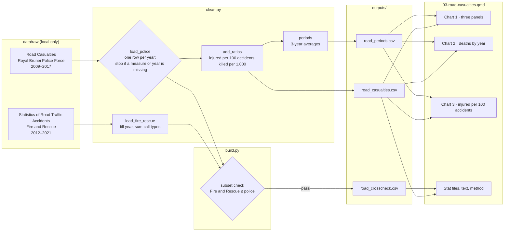

# 03 — Process record: Road casualties

How the data for this study was worked on, from download to published page, and why each
choice was made. Follows [docs/WORKFLOW.md](../../docs/WORKFLOW.md). Repo only, not on the site.

**Status:** built 16 Oct 2026, not yet published (awaiting the author's push) · **Last updated:** 16 Oct 2026

## Data lineage



## 1. Acquire

| Dataset | Owner (as listed) | Edition | File | Downloaded |
|---|---|---|---|---|
| [Road Casualties](https://www.data.gov.bn/road-casualties/) | Royal Brunei Police Force | 2025 (no year in title) | `1-Road-Casualities.xlsx` | 16 Oct 2026 |
| [Statistics of Road Traffic Accidents](https://www.data.gov.bn/statistics-of-road-traffic-accidents/) | Fire and Rescue Department Brunei Darussalam | 2025 (no year in title) | `STATISTIC-OF-ROAD-TRAFFIC-ACCIDENTS-FROM-2012-TO-2021.xlsx`, `Data-Definition-of-Road-Traffic-Accidents.xlsx` | 16 Oct 2026 |

Logged in `DATA_SOURCES.md`. Terms of Use re-checked on 16 Oct 2026 (same day as case study 02).
Three Ministry of Health road traffic sets (2008–2012) were looked at in the catalogue but not
downloaded: they cover hospital cases, and stop in 2012.

The download helper wrote the records without a coverage period (none was passed on the first
download), so coverage was added to the `.meta.json` files afterwards without downloading again.

## 2. Inspect

- **Police table:** tidy long format (Year, Type, Amount), newest year first, 27 rows: three
  measures for each year 2009–2017. No formulas, no merged cells.
- **Units:** "Accidents" counts events; "Injuries" and "Deaths" count people.
- **Pattern:** accidents between 3,110 and 3,598 a year; injuries and deaths drop in one step
  from 2011 to 2012 (−30% and −40%) and stay lower.
- **Deaths are noisy:** 17 to 47 a year.
- **Fire and Rescue table:** header on the second row; each year a merged cell over two call
  types ("car accident", "car accident involving fire"). Its data definition says it covers
  only accidents its crews attended.
- **Known issues:** 6 (police) and 3 (Fire and Rescue), in `DATA_SOURCES.md`.

## 3. Clean

| # | Step | How (code) | Why |
|---|---|---|---|
| 1 | Trim column names and type labels | `clean.py:load_police` | Avoids silent mismatches from stray spaces |
| 2 | Stop if the types aren't exactly Accidents, Injuries and Deaths | `clean.py:load_police` | A renamed or extra type in a new edition must be looked at, not guessed |
| 3 | Pivot to one row per year, one column per measure | `clean.py:load_police` | Each measure has one unit; ratios need them side by side |
| 4 | Stop if a year has a duplicate or missing measure, or a year is skipped | `clean.py:load_police` | Period averages would quietly use fewer years otherwise |
| 5 | Fire and Rescue: read the header from row 2, fill the year down, sum both call types | `clean.py:load_fire_rescue` | Matches the layout. Summing hides the 0–2 counts by call type (SOP 7) and gives a yearly total to compare |

Values flagged rather than removed: none needed. No values were corrected.

## 4. Validate

| Check | Rule | Result |
|---|---|---|
| Structure | Steps 2 and 4 above stop the build | Pass |
| Schema | pandera: one row per year, accidents > 0, counts ≥ 0, ratios in range | Pass |
| Whole periods | `periods` refuses if the years don't split into 3-year blocks | Pass: 9 years = 3 periods |
| Cross-check | Fire and Rescue deaths and injuries ≤ police totals in each overlapping year (it's a subset). Build stops otherwise | Pass, 2012–2017 |
| Unit tests | `tests/test_case03_clean.py`: reshape; missing year or measure refused; period ratio uses totals; whole periods only; Fire and Rescue fill and sum | Pass (synthetic tables) |

The cross-check confirms the police totals are plausible, but it can't test the 2012 step,
because Fire and Rescue's data starts in 2012.

## 5. Process

| Output | Built from | Calculation | Why |
|---|---|---|---|
| `road_casualties.csv` | police table | injured per 100 accidents; killed per 1,000 accidents | Answers "did accidents become less likely to injure or kill?" Deaths per 1,000 because deaths per 100 would be fractions |
| `road_periods.csv` | yearly table | averages over 2009–2011, 2012–2014, 2015–2017; period ratios = period totals ÷ period accidents | Deaths swing 17–47 a year, so single years mislead. Equal 3-year blocks split 9 years evenly. Totals-based ratios weight each accident equally (an average of yearly ratios wouldn't) |
| `road_crosscheck.csv` | police + Fire and Rescue | side by side, `within_police_total` | Evidence for the method section |

The page computes period figures from the yearly counts, not from the rounded averages, to
avoid double rounding (the lesson from case study 02).

## 6. Visualise

| Chart | Output used | Chart type | Why this form |
|---|---|---|---|
| 1 · Accidents, injured, killed | both | Three small line panels, each from zero on its own scale, with dotted period averages. 3 across on desktop, stacked on phones | The three measures differ by 100× in size. One shared axis would flatten deaths into a line at zero |
| 2 · Deaths by year | both | Grey bars with teal period-average lines, labelled | Shows how much single years swing, and why the averages are used |
| 3 · Injured per 100 accidents | both | Line with dotted period averages | The clearest view of the step in 2012 |

Dropped during QA: value labels on the dotted lines in charts 1 and 3 overlapped the data
points. The values are already in the text, the tiles and the hover, so only chart 2 keeps them.

## 7. Post-process

- [x] Small counts: not applicable to the police data (national yearly totals, at least 17). Fire and Rescue's 0–2 counts by call type are summed and not published
- [x] Source + retrieval date on every chart; APA references in method (both datasets)
- [x] Disclaimer and AI-assistance byline
- [x] Neutral wording: "recorded", "as recorded, yes"; the 2012 step is described with both possible causes and no claim about either; no comment on road safety policy
- [x] Data period on title, cards and every subtitle; intro says the data ends in 2017 though published in 2025
- [ ] Translations: not enabled
- [x] Phone and desktop screenshots checked (390 px and 1280 px)
- [x] `uv run pytest` passes (47 tests)

## Decision log

| Date | Decision | Options considered | Reason |
|---|---|---|---|
| 16 Oct 2026 | Police table as the only charted source | Combine with Fire and Rescue or Ministry of Health | Fire and Rescue counts only accidents it attended; Ministry of Health covers hospital cases to 2012. Different measures can't be added or compared directly |
| 16 Oct 2026 | Use Fire and Rescue as a cross-check | Ignore it | A subset gives a cheap plausibility check (never above the police totals) |
| 16 Oct 2026 | Compare 3-year averages | Single years; 2009 vs 2017 | Deaths vary 17–47 a year. Single-year comparisons could show almost any change |
| 16 Oct 2026 | Report the 2012 step without a cause | Explain it | The source gives no reason. Recording changes are as possible as a real fall |
| 16 Oct 2026 | No rates per population or vehicle | Add population from data.gov.bn or World Bank | Keeps the study to one source and its questions. Noted as a limitation; could be added later |
| 16 Oct 2026 | No "good"/"bad" colour on the tiles | Mark falls as improvements | Consistent with case study 02; the tiles state changes and the reader judges them |

## Reproduce

```sh
uv run python case_studies/03_road_casualties/analysis/build.py
uv run quarto preview dashboard
```
