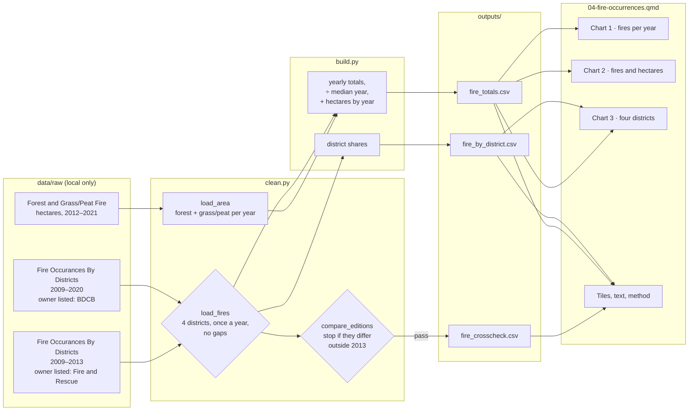

# 04 — Process record: Fire occurrences by district

How the data for this study was worked on, from download to published page, and why each
choice was made. Follows [docs/WORKFLOW.md](../../docs/WORKFLOW.md). Repo only, not on the site.

**Status:** built 16 Oct 2026, not yet published (awaiting the author's push) · **Last updated:** 16 Oct 2026

## Data lineage



## 1. Acquire

| Dataset | Owner (as listed) | Edition | File | Downloaded |
|---|---|---|---|---|
| [Fire Occurances By Districts](https://www.data.gov.bn/fire-occurances-by-districts/) | Brunei Darussalam Central Bank | 2025 (no year in title) | `Fire-Occurances-By-Districts.xlsx` | 16 Oct 2026 |
| [Fire Occurances By Districts](https://www.data.gov.bn/fire-occurances-by-districts-2/) | Brunei Fire and Rescue Department | 2025 (no year in title) | `4-Fire-Occurances-By-Districts.xlsx` | 16 Oct 2026 |
| [Statistic of Forest and Grass/Peat Fire](https://www.data.gov.bn/statistic-of-forest-and-grass-peat-fire/) | Fire and Rescue Department Brunei Darussalam | 2025 | `STATISTIC-OF-FOREST-AND-GRASS-FIRE-FROM-2012-TO-2021.xlsx` | 16 Oct 2026 |

Logged in `DATA_SOURCES.md`. Terms of Use re-checked on 16 Oct 2026. Not downloaded: the
2012–2016 forest and grass fire edition (covered by the 2012–2021 one), and "Houses on water
affected by fire by Kampung" (village-level counts; a separate topic with privacy questions).
Both fire-occurrence files share the `2025` folder, since the download helper takes a year as
the edition and their file names differ.

## 2. Inspect

- **Both editions:** tidy long tables (Year, District, Amount), newest year first, four
  districts. The 2009–2020 edition has 48 rows; the 2009–2013 edition 20.
- **Agreement:** identical by district for 2009–2012; 2013 differs (791 vs 265 in total).
- **Owners:** the longer edition lists the Brunei Darussalam Central Bank; the shorter one, the
  Brunei Fire and Rescue Department.
- **Pattern:** 2010 = 4,299 fires, 3.6× the median year, high in all four districts; smaller
  peaks in 2016 and 2019. Temburong's counts are small (6–104).
- **Area table:** hectares of forest and grass/peat burned; "FOREST FIRE " has a trailing
  space; header "HECTRES".
- **Known issues:** 5 (fire occurrences) and 2 (area), in `DATA_SOURCES.md`.

## 3. Clean

| # | Step | How (code) | Why |
|---|---|---|---|
| 1 | Trim names; stop if the districts aren't exactly the four, a district appears twice in a year, a year lacks a district, or a year is skipped | `clean.py:load_fires` | Yearly totals would silently be wrong otherwise |
| 2 | "Brunei Muara" → "Brunei-Muara" | `clean.py:DISTRICTS` | Official spelling on the page; the data table keeps the meaning |
| 3 | Compare editions district by district; stop if they differ in any year other than 2013 | `clean.py:compare_editions` | 2013 is a known, logged difference. Anything new must be looked at first |
| 4 | Area table: trim labels, one row per year, forest + grass/peat = total | `clean.py:load_area` | Gives a yearly hectare figure to compare with fire counts |

Values flagged rather than removed: none. No values were corrected.

## 4. Validate

| Check | Rule | Result |
|---|---|---|
| Structure | Step 1 above stops the build | Pass |
| Editions | Step 3 above | Pass: 2009–2012 identical; 2013 differs as logged |
| Schemas | pandera: one row per year × district, shares 0–100%, counts ≥ 0, hectares ≥ 0 | Pass |
| Page claim | The page states that every district's three highest years match the national three; the page build stops (`assert`) if that stops being true | Pass |
| Unit tests | `tests/test_case04_clean.py`: renaming and sorting; missing district or year refused; editions may differ only in known years; area summed | Pass (synthetic tables) |

## 5. Process

| Output | Built from | Calculation | Why |
|---|---|---|---|
| `fire_by_district.csv` | 2009–2020 edition | share of each year's total | "Where did fires happen?" |
| `fire_totals.csv` | districts summed + area table | each year ÷ median year; hectares joined by year | The median is a fairer "typical year" than the mean, which 2010 pulls up (mean 1,473 vs median 1,187) |
| `fire_crosscheck.csv` | both editions | yearly totals side by side, `same_by_district` | Evidence for the method and the 2013 caveat |

Computed on the page from the outputs: the correlation between fires and hectares (0.97,
2012–2020), the median of 2009–2014 vs 2015–2020, and the peak-year ranks by district.

## 6. Visualise

| Chart | Output used | Chart type | Why this form |
|---|---|---|---|
| 1 · Fires per year | `fire_totals` | Bars; the three highest years teal, others grey; dotted median line | Separate yearly counts; the median line shows what "typical" means |
| 2 · Fires and hectares | `fire_totals` | Two bar panels side by side (stacked on phones), same teal years | Different units, so two panels instead of a dual axis. The same teal years show they move together |
| 3 · Four districts | both | Small multiples, each on its own scale | Temburong's counts are ~1/25 of Brunei-Muara's; a shared scale would flatten three panels. The same teal years in every panel show the shared peaks |

QA fixes: the median label overlapped bars, so it now sits over the longest run of
below-median years; a bold sentence built in inline code showed raw asterisks, so the bold is
now in the text and the claim is checked by an `assert`.

## Context sources

| Key | Source | Tier (1 journal · 2 official · 3 news) | Supports | Checked how |
|---|---|---|---|---|
| `langner2009` | Langner & Siegert (2009), *Global Change Biology* 15(1) | 1 | Borneo fire area ~3× in El Niño years, but the increase was in Kalimantan, not Brunei; drought alone doesn't explain fire | Abstract via OpenAlex; issue year via Crossref |
| `varkkey2024` | Varkkey & Lupascu (2024), *Singapore Journal of Tropical Geography* 45(1) | 1 | Brunei's peat fires occur in disturbed peatland, rooted in infrastructure development | Abstract via OpenAlex; issue year via Crossref |

Looked at, not used: Dotse et al. (2016, Universiti Brunei Darussalam) on haze and PM10, which
is about regional smoke, not fires in Brunei.

## 7. Post-process

- [x] Small counts: fires are events, not people; all counts in the edition used are ≥ 5. The other edition's 2013 Temburong value (3) appears only inside a yearly total
- [x] Source + retrieval date on every chart; APA references in method (three datasets, two studies)
- [x] Disclaimer and AI-assistance byline
- [x] Neutral wording: "recorded", no comment on fire services; the correlation is described as moving together, not as cause
- [x] Context: peer-reviewed only, in a separate callout that says neither study explains these years; includes the finding that cuts against a drought explanation for Brunei
- [x] Data period on title, cards and every subtitle
- [ ] Translations: not enabled
- [x] Phone and desktop screenshots checked (390 px and 1280 px)
- [x] `uv run pytest` passes (65 tests)

## Decision log

| Date | Decision | Options considered | Reason |
|---|---|---|---|
| 16 Oct 2026 | Use the 2009–2020 edition; the 2009–2013 one as a cross-check | Use the Fire and Rescue edition | Longer, later, and identical where both have data except 2013 |
| 16 Oct 2026 | Credit the longer edition to the Brunei Darussalam Central Bank, as listed | Credit Fire and Rescue | Policy: owner exactly as listed. The method says which owner each edition lists; the EGNC email asks about owner names |
| 16 Oct 2026 | Show hectares burned beside fire counts, never added | Leave out; add up | A different measure, but its year pattern helps readers see the peaks are real |
| 16 Oct 2026 | Median as the "typical year" | Mean | 2010 pulls the mean up by ~290 |
| 16 Oct 2026 | No fires per person or per km² | Add district population/area | Keeps to the published tables; stated as a limitation. A later update could add rates |
| 16 Oct 2026 | Report a study that found El Niño didn't raise fire in Brunei | Report only drought-fire links | Balance: it cuts against the obvious explanation, so readers shouldn't assume drought |

## Reproduce

```sh
uv run python case_studies/04_fire_occurrences/analysis/build.py
uv run quarto preview dashboard
```
