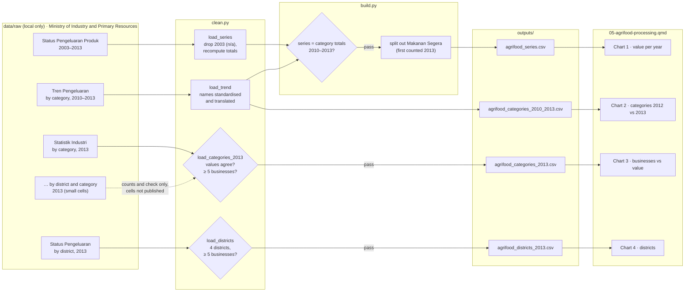

# 05 — Process record: Agrifood processing (agrimakanan)

How the data for this study was worked on, from download to published page, and why each
choice was made. Follows [docs/WORKFLOW.md](../../docs/WORKFLOW.md). Repo only, not on the site.

**Status:** built 16 Oct 2026, not yet published (awaiting the author's push) · **Last updated:** 16 Oct 2026

Scope agreed with the author (16 Oct 2026): the agrimakanan topic is split in two. This is
part (a), the five agrimakanan tables; part (b) is the livestock industry series (1992–2020).

## Data lineage



## 1. Acquire

| Dataset (Malay, as published) | English (APA bracket) | File | Downloaded |
|---|---|---|---|
| [Status Pengeluaran Produck Agrimakanan](https://www.data.gov.bn/status-pengeluaran-produck-agrimakanan/) | Status of agrifood product production | `STATUS-PENGELUARAN-PRODUK-AGRIMAKANAN-2003-2012.xlsx` | 16 Oct 2026 |
| [Tren Pengeluaran Agrimakanan Mengikut Kategori Produk](https://www.data.gov.bn/tren-pengeluaran-agrimakanan-mengikut-kategori-produk/) | Agrifood production trends by product category | `TREN-PENGELUARAN-AGRIMAKANAN-MENGIKUT-KATEGORI-PRODUK-2010-2013.xlsx` | 16 Oct 2026 |
| [Statistik Industri Agrimakanan](https://www.data.gov.bn/statistik-industri-agrimakanan/) | Agrifood industry statistics | `STATISTIK-INDUSTRI-AGRIMAKANAN-2013.xlsx` | 16 Oct 2026 |
| [Statistik Industri Agrimakanan Mengikut Daerah Dan Kategori Produck](https://www.data.gov.bn/statistik-industri-agrimakanan-mengikut-daerah-dan-kategori-produck/) | … by district and product category | `STATISTIK-INDUSTRI-AGRIMAKANAN-MENGIKUT-DAERAH-DAN-KATEGORI-PRODUK-2013.xlsx` | 16 Oct 2026 |
| [Status Pengeluaran Agrimakanan Mengikut Daerah](https://www.data.gov.bn/status-pengeluaran-agrimakanan-mengikut-daerah/) | Status of agrifood production by district | `STATUS-PENGELUARAN-AGRIMAKANAN-MENGIKUT-DAERAH-2013.xlsx` | 16 Oct 2026 |

All owned by the Ministry of Industry and Primary Resources, published 22 Dec 2025. Logged in
`DATA_SOURCES.md`. New in this study: `Provenance.title_translation`, so APA references show
the English translation of Malay titles in square brackets.

## 2. Inspect

- **Topic:** food processing (manufactured products), not farming.
- **Shapes:** five small, tidy tables; Malay headers and names; values in B$ (one table in
  B$ million).
- **Agreement:** market values agree across all five tables to the dollar.
- **Disagreement:** head-counts. The category × district table sums to 548 businesses and 3,495
  employees; the district table says 225 and 1,739.
- **Coverage break:** "Makanan Segera" appears only in 2013, at B$34.5m (40% of the total).
- **Missing value:** 2003 crop-based value "n/a"; the published change column treats it as 0.
- **Small cells:** 17 of 52 category × district cells have 1–4 businesses.
- **Known issues:** 8, in `DATA_SOURCES.md`.

## 3. Clean

| # | Step | How (code) | Why |
|---|---|---|---|
| 1 | Map every category spelling to one Malay name and one English name; stop on an unknown name | `clean.py:CATEGORIES`, `_category` | The tables spell names differently ("Mi"/"Mee", "dan"/"&"); an unmapped name would silently drop out |
| 2 | Merge "Acar & Jeruk" (pickles) into "Lain-lain" (Other) | `clean.py:CATEGORIES` | One table lists it separately, the other inside Other; merging makes them match |
| 3 | Drop 2003; recompute totals and changes | `clean.py:load_series` | 2003's crop-based value is missing; the published change for 2004 (+B$16.5m) is an artefact of treating it as zero |
| 4 | Convert B$ million to B$ | `clean.py:load_trend` | One unit across outputs |
| 5 | Business counts per category from the cross-tab, summed over districts | `clean.py:load_categories_2013` | The only per-category count available. The cells themselves are never published |
| 6 | Stop if any published category or district rests on fewer than 5 businesses | `clean.py:MIN_BUSINESSES` | SOP 7 and business confidentiality |
| 7 | District names: "Brunei/Muara" → Brunei-Muara | `clean.py:DISTRICTS` | Official spelling |

Values flagged rather than removed: none. No values were corrected.

## 4. Validate

| Check | Rule | Result |
|---|---|---|
| Category values vs 2013 table | Equal within B$1 per category | Pass |
| Series vs category table | Yearly totals equal within B$10,000 (2010 values are rounded to B$0.01m) | Pass for 2010–2013 |
| Small cells | No published category or district below 5 businesses | Pass (smallest: ice cream and soya bean products, 6) |
| Series schema | One row per year; positive values | Pass |
| Page claims | "Rose every year to 2012" is asserted before it is stated | Pass |
| Unit tests | `tests/test_case05_clean.py`: name mapping; 2003 dropped and totals recomputed; a category with 4 businesses is refused | Pass (synthetic tables) |

## 5. Process

| Output | Built from | Calculation | Why |
|---|---|---|---|
| `agrifood_series.csv` | series + category table | total = livestock + crop; `new_category_bnd` = Makanan Segera; `comparable_bnd` = total − it | Separates real change from a coverage change |
| `agrifood_categories_2010_2013.csv` | category table | B$; names translated | Which categories moved in 2013 |
| `agrifood_categories_2013.csv` | 2013 table + cross-tab counts | share of value; businesses | "Many small producers" |
| `agrifood_districts_2013.csv` | district table | shares of businesses, employees, value | "Where was it based?" |

Assumption, stated on the page: the category table starts in 2010, so for 2004–2009 the whole
total is treated as "categories counted every year".

## 6. Visualise

| Chart | Output used | Chart type | Why this form |
|---|---|---|---|
| 1 · Value per year | series | Stacked bars: teal = counted every year, grey = the 2013 newcomer | Shows the rise and the 2013 fall in one view, without the newcomer reading as growth |
| 2 · Categories, 2012 vs 2013 | categories 2010–2013 | Grouped horizontal bars (2012 grey, 2013 teal) | Same form as case study 02; long Malay-to-English names read best horizontally |
| 3 · Businesses vs value | categories 2013 | Two share panels side by side (stacked on phones), traditional foods teal | The gap between "how many make it" and "how much it's worth" |
| 4 · Districts | districts 2013 | Three share panels (businesses, employees, value), Brunei-Muara teal | The same district concentrates more at each step |
| 5 · District maps (added 19 Oct 2026) | districts 2013 + `_shared/outputs/brunei_districts.csv` | Three small maps, stepped teal fills (under 5%, 5–20%, 20–50%, 50%+), each district labelled with its share; static SVG (`shared.svg.district_map`) | Shows *where* the industry was, which bars can't. Shares are of one industry, not of people, so no per-person rate is needed. Brunei-Muara's label sits outside with a leader line on small maps |

QA fixes (16 Oct 2026, second pass): striped bars rendered transparent until Plotly's
`fillmode="overlay"` was set; the 2013 legend swatch took the first bar's stripes, so the legend
now uses plain swatches. Earlier: shares under 1% showed as "0%" and now show one decimal; a wrapped line starting with
inline code ("`{python} LAST`. The…") rendered as a numbered list, so it was rewrapped and the
format test now catches inline code too; an ambiguous "(31)" was reworded.

## Context sources

| Key | Source | Tier (1 journal · 2 official · 3 news) | Supports | Checked how |
|---|---|---|---|---|
| `searca2016` | Hajah Aidah binti Haji Mohd Hanifah et al. (2016), SEARCA primer | 2 | 2008–2013 plan; SMEs; Small Entrepreneurs Food Incubator Centre; Brunei Halal Brand | Full abstract via RePEc; series/number/year from its record |
| `khut2026` | Khut (2026), AMRO annual consultation report, Selected Issue 3 | 2 | Processing output 2015 → 2024; imports > 70% of food; weak linkages | Full PDF read |

No peer-reviewed study of the industry for 2004–2013 was found; the page says so. Looked at,
not used: a 2025 Springer chapter on halal food security (Universiti Brunei Darussalam; off
topic for these years), and a Universiti Brunei Darussalam journal article (site blocks
automated access, so it couldn't be checked).

The author names in `searca2016` are given exactly as published, including "Hajah" (the
author's preference, 16 Oct 2026). Malay names have no family name, so APA uses the full name.

## 7. Post-process

- [x] Small counts: category × district cells never published; every published category and district has ≥ 5 businesses (build stops otherwise)
- [x] Source + retrieval date on every chart; APA references with English translations of Malay titles
- [x] Disclaimer and AI-assistance byline
- [x] Neutral wording: "counted", "recorded"; the 2013 fall and the new category stated side by side; no comment on policy success
- [x] Context: two institutional reports in a separate callout, which says their figures can't be joined to ours
- [x] Data period on title, cards and every subtitle
- [x] Glossary terms marked: market-value, new-item, continued-item, livestock-based, crop-based, current-prices, share-of-businesses, share-of-market-value
- [x] Item status: fast or instant food is "new" (striped, labelled "new in 2013") in charts 1 and 2; `status` column in `agrifood_categories_2010_2013.csv`
- [ ] Translations: not enabled (Malay names kept in every output for later)
- [x] Phone and desktop screenshots checked (390 px and 1280 px)
- [x] `uv run pytest` passes (73 tests)

## Decision log

| Date | Decision | Options considered | Reason |
|---|---|---|---|
| 16 Oct 2026 | Split agrimakanan into (a) these tables and (b) the livestock series | One study of ~190 datasets | Author agreed; keeps each study answerable |
| 19 Oct 2026 | Add chart 5, district maps, with a dated Update note | Plotly choropleth; one map of value only | Author approved geoBoundaries as a source (policy §6). Plotly's basic bundle has no maps and the full one breaks the page budget, so static SVG. Three maps keep chart 4's "concentrates more at each step" message |
| 16 Oct 2026 | Treat Makanan Segera as a coverage change and compare without it | Report 2013 as +37% growth | It is 0 in 2010–2012 and 40% of 2013; calling it growth would mislead (Terms of Use) |
| 16 Oct 2026 | Start in 2004 and ignore the published change column | Use 2003 and the column | 2003's crop value is missing; the column treats it as zero |
| 16 Oct 2026 | Head-counts from the district table | Category table | The category table counts a business once per product type |
| 16 Oct 2026 | Don't publish category × district cells | Publish as released | 17 cells rest on 1–4 businesses; a value there can reveal one firm's sales |
| 16 Oct 2026 | Translate Malay titles in APA brackets; keep Malay names in outputs | English names only | APA 7 rule; prepares the Malay version of the site |
| 16 Oct 2026 | Quote AMRO's 2015–2024 figures in text only | Extend the chart | Definitions may differ (policy §7 rule 1) |
| 16 Oct 2026 | No inflation adjustment | Deflate with CPI | Keeps to one publisher's tables; stated as a limitation |

## Reproduce

```sh
uv run python case_studies/05_agrifood_processing/analysis/build.py
uv run quarto preview dashboard
```
