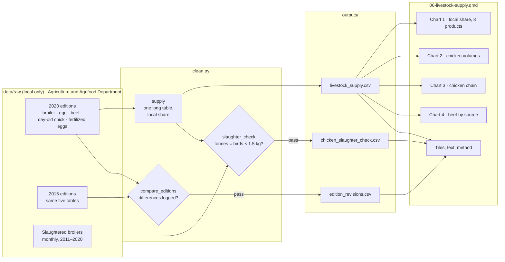

# 06 — Process record: Livestock supply (chicken, eggs and beef)

How the data for this study was worked on, from download to published page, and why each
choice was made. Follows [docs/WORKFLOW.md](../../docs/WORKFLOW.md). Repo only, not on the site.

**Status:** built 16 Oct 2026, not yet published (awaiting the author's push) · **Last updated:** 16 Oct 2026

Part (b) of the agrimakanan topic (scope agreed with the author on 16 Oct 2026).

## Data lineage



## 1. Acquire

| Dataset | Owner (as listed) | Edition | File | Downloaded |
|---|---|---|---|---|
| BROILER INDUSTRY YEAR 1992-2020 | Agriculture and Agrifood Department | 2020 | `Broiler-Industry-1992-2020.xlsx` | 16 Oct 2026 |
| Egg Industry, Year 1992-2020 | 〃 | 2020 | `Egg-Industry-1992-2020.xlsx` | 16 Oct 2026 |
| Beef Industry, Year 1995-2020 | 〃 | 2020 | `Beef-Industry-1995-2020.xlsx` | 16 Oct 2026 |
| Day Old Chick Industry Year 2001-2020 | 〃 | 2020 | `Day-Old-Chick-Industry-2001-2020.xlsx` | 16 Oct 2026 |
| Fertilized Eggs Industry , Year 2011-2020 | 〃 | 2020 | `Fertilized-Eggs-Industry-2001-2020.xlsx` | 16 Oct 2026 |
| Number Of Slaughtered Broilers, 2011-2020 | 〃 | 2020 | `Number-of-Slaughtered-Broilers-2011-2020.xlsx` | 16 Oct 2026 |
| Same five industry tables, 1992/1995/2001–2015 | Department of Agriculture and Agrifood, Ministry of Primary Resources and Tourism | 2015 | `*-2015.xlsx` | 16 Oct 2026 |

Logged in `DATA_SOURCES.md`. Not used: monthly chicken meat by district (a separate, district
topic), imported livestock by number, goat breeders (2011–2015 only).

## 2. Inspect

- **Shape:** small tidy tables, one row per year, newest first; local production and imports
  (beef: imports split into live and chilled & frozen). Some files have blank spacer columns.
- **Units:** chicken and beef in tonnes; eggs in million eggs; chicks and hatching eggs in birds/eggs.
- **Editions:** 2020 and 2015 agree in every shared year except 2015 chicken imports (revised).
- **Derived figure:** local chicken tonnes = birds slaughtered × 1.5 kg, exactly, 2011–2020.
- **Quirks:** egg column headed "Monthly" but holds yearly values; beef imports "n/a" before
  2000; chilled & frozen beef 0 until 2005; a copied month (October 2018); a fractional bird.
- **Known issues:** 10, in `DATA_SOURCES.md` → "Livestock industry tables".

## 3. Clean

| # | Step | How (code) | Why |
|---|---|---|---|
| 1 | Drop blank spacer columns; trim names | `clean.py:read_table` | Two files have empty first columns |
| 2 | Map each table's columns to local and imports; stop if a column is missing | `clean.py:PRODUCTS`, `supply` | Five tables with five header styles |
| 3 | Read the "Monthly Production" egg column as yearly | `clean.py:PRODUCTS` | Values are yearly (issue 5) |
| 4 | Drop years with "n/a"; stop if the remaining years have gaps | `clean.py:supply` | Beef 1995–1999 has no import data |
| 5 | Beef imports = live + chilled & frozen, both kept | `clean.py:supply` | Total supply needs both; chart 4 shows them apart |
| 6 | Local share = local ÷ (local + imports) | `clean.py:supply` | The only measure the data supports (no exports or stocks) |

Values flagged rather than removed: none. No values were corrected.

## 4. Validate

| Check | Rule | Result |
|---|---|---|
| Editions | Every difference between the 2020 and 2015 editions must be logged; the build stops otherwise | Pass: only 2015 chicken imports (3,220.44 vs 3,317.64 t) |
| Chicken tonnes vs birds | Tonnes = birds × 1.5 kg (±0.001 kg) every year; the build stops otherwise | Pass, 2011–2020 |
| Monthly sums | Recorded per year (`months_match_total`) | 2018 differs by 9,608 birds (October copies September); the published total matches the tonnes, so it is used |
| Schema | One row per product × year; local share 0–100% | Pass |
| Page claims | The chain getting less local after 2010, and one weight per bird, are asserted before being stated | Pass |
| Unit tests | `tests/test_case06_clean.py`: local share and order; beef n/a years and import sum; unlogged edition differences refused; 1.5 kg rule enforced | Pass (synthetic tables) |

## 5. Process

| Output | Built from | Calculation | Why |
|---|---|---|---|
| `livestock_supply.csv` | 2020 editions | local share; beef import types kept | All four charts and the tiles |
| `chicken_slaughter_check.csv` | slaughter table + chicken | kg per bird; months vs total | Evidence for the "estimated from bird counts" note |
| `edition_revisions.csv` | 2020 vs 2015 editions | values that differ | Evidence for the method section |

## 6. Visualise

| Chart | Output used | Chart type | Why this form |
|---|---|---|---|
| 1 · Local share, 3 products | supply | Three area panels, each 0–100% (stacked on phones) | Same scale makes chicken's rise, eggs' flat line and beef's floor comparable at a glance |
| 2 · Chicken volumes | supply | Stacked bars: local teal, imports grey | Shows that the share rose because local production grew, not only because imports fell |
| 3 · Chicken chain | supply | Grouped horizontal bars, 2010 grey vs 2020 teal, steps in chain order with "hatch into / grow into" | Reads top to bottom like the chain |
| 4 · Beef by source | supply | Stacked bars: local teal, live imports dark grey, chilled & frozen light grey | Teal always means local; the two greys separate import types |

QA fixes: live imports were first drawn in a second teal, which broke "teal = local", so they
are now dark grey; the "first recorded" annotation was clipped by tall bars, so it moved into
the subtitle; a wrapped line ending "`{python} LAST`." became a numbered list item, so it was
rewrapped and the format test now also catches a line that is only inline code and a full stop;
a sentence saying most imported beef arrived live was wrong for most years (chilled & frozen was
larger in 13 of 15 years from 2006) and was rewritten.

## Context sources

| Key | Source | Tier (1 journal · 2 official · 3 news) | Supports | Checked how |
|---|---|---|---|---|
| `mohamed2004` | Zainal Abidin Mohamed et al. (2004), *J. Int. Food & Agribusiness Marketing* 15(1–2) | 1 | Protection; comparative advantage only for very large poultry and egg farms; beef at a disadvantage | Abstract via OpenAlex |
| `musa2021` | Siti Fatimahwati Pehin Dato Musa & Khairul Hidayatullah Basir (2021), *IOP Conf. Ser.: Earth Environ. Sci.* 756 | 1 | Near 100% of demand for eggs and chicken before COVID-19; shortages during it | Abstract via OpenAlex |
| `takami2023` | Takami & Aghwan (2023), *Southeast Asia: History and Culture* 52 | 1 | Beef today: live imports slaughtered in local halal abattoirs | Abstract via OpenAlex |
| `searca2016` | Hajah Aidah binti Haji Mohd Hanifah et al. (2016), SEARCA | 2 | "Poultry and eggs … nearly 100 percent self-sufficiency since 1994", compared with the data (true for eggs, not chicken meat) | Abstract via RePEc |
| `khut2026` | Khut (2026), AMRO | 2 | Chicken meat and eggs above 100% self-sufficiency since 2020; beef substantially lower | Full PDF |

Left out: news about Brunei-owned cattle stations in Australia (news only, centred on the head
of state; neutrality rule).

## 7. Post-process

- [x] Small counts: not applicable (national yearly totals)
- [x] Source + retrieval date on every chart; APA references (6 datasets in the list, 5 context sources)
- [x] Disclaimer and AI-assistance byline
- [x] Neutral wording: "local share", not "success"; the 2020 import drop stated without a cause
- [x] Context: peer-reviewed first; a report's claim is compared with the data rather than repeated
- [x] Data period on title, cards and every subtitle
- [x] Glossary terms marked: local-share-of-supply, self-sufficiency-ratio, day-old-chick, hatching-egg (4 new)
- [x] Item status: not applicable (the same products in every year); beef's chilled & frozen imports "first recorded in 2005" is stated in the subtitle and caveats
- [ ] Translations: not enabled
- [x] Phone and desktop screenshots checked (390 px and 1280 px)
- [x] `uv run pytest` passes (91 tests)

## Decision log

| Date | Decision | Options considered | Reason |
|---|---|---|---|
| 16 Oct 2026 | Measure "local share of supply", not "self-sufficiency" | Call it self-sufficiency | No export or stock data; the official ratio is different and can exceed 100%. Both are in the glossary |
| 16 Oct 2026 | Use the 2020 editions; 2015 editions as a check | Use either | Later and longer; identical except one logged revision |
| 16 Oct 2026 | Say that local chicken tonnes are estimated from bird counts | Present as measured | Exact 1.5 kg per bird in every year; readers should know |
| 16 Oct 2026 | Use published yearly slaughter totals, not month sums | Sum months | The total matches the meat figure; October 2018 copies September |
| 16 Oct 2026 | Beef from 2000 only | Start 1995 | Imports are "n/a" before 2000 |
| 16 Oct 2026 | Compare a report's claim (since 1994) with the data | Quote it as is | It holds for eggs but not chicken meat; repeating it would mislead |
| 16 Oct 2026 | Leave out the Australian cattle-station story | Include from news | News only, and centred on the head of state |

## Reproduce

```sh
uv run python case_studies/06_livestock_supply/analysis/build.py
uv run quarto preview dashboard
```
