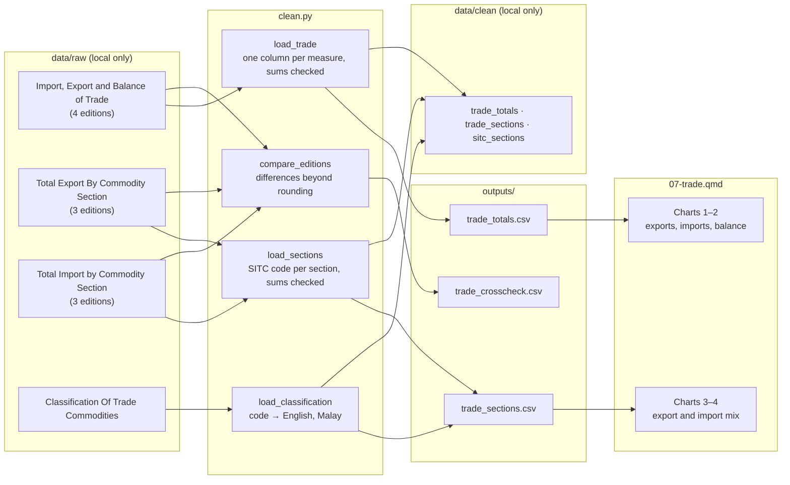

# 07 — Process record: Trade, 2000–2021

How the data for this study was worked on, from download to published page, and why each
choice was made. Follows [docs/WORKFLOW.md](../../docs/WORKFLOW.md). Repo only, not on the site.

**Status:** published 17 Oct 2026 · **Last updated:** 17 Oct 2026

## Data lineage



## 1. Acquire

| Dataset | Owner (as listed) | Edition | File | Downloaded |
|---|---|---|---|---|
| Import, Export and Balance of Trade | Department of Statistics, JPES | 2025 (variant `dos-jpes`) | `Import-Export-and-Balance-of-Trade.xlsx` (2025/11) | 17 Oct 2026 |
| Import, Export and Balance of Trade | JPES | 2025 (`jpes`) | `Import-Export-and-Balance-of-Trade.xlsx` (2025/12) | 17 Oct 2026 |
| Import, Export And Balance Of Trade | Department of Economic Planning and Statistics | 2025 (`deps`) | `Import-Export-and-Balance-of-Trade-1.xlsx` | 17 Oct 2026 |
| Inport, Export And Balance Of Trade | Department of Economic Planning and Development | 2025 (`depd`) | `2-Inport-Export-And-Balance-Of-Trade.xlsx` | 17 Oct 2026 |
| Total Export By Commodity Section | Department of Statistics, JPES / JPES / DEPS | 2025 (3 variants) | `Total-Export-…` | 17 Oct 2026 |
| Total Import by Commodity Section | Department of Statistics, JPES / JPES / DEPS | 2025 (3 variants) | `Total-Import-…` | 17 Oct 2026 |
| Classification Of Trade Commodities | Department of Economic Planning and Development | 2025 (`depd`) | `1-Classification-Of-Trade-Commodities.xlsx` | 17 Oct 2026 |

Logged in `DATA_SOURCES.md`. Terms of Use re-checked on 17 Oct 2026 (key clauses unchanged).
Owners, titles and coverage were read from each dataset page before downloading.

## 2. Inspect

- **Shape:** long tables, one sheet each: year, measure (or section), value. 6 measures per year in
  the totals tables (4 in the DEPD edition), 10 sections per year (plus a "Total Import" row in the
  import tables).
- **Columns:** BND million at current prices.
- **Coverage:** totals 2000–2021, exports by section 2009–2021, imports by section 2000–2021 (main
  editions); other editions end in 2013, 2018 or 2020.
- **Quirks:** mixed precision (full values and values rounded to 0.1 million); section names differ
  between editions; DEPD title spelled "Inport"; two files share a name.
- **Known issues:** DATA_SOURCES.md, "Trade tables" (issues 1–7).

## 3. Clean

| # | Step | How (code) | Why |
|---|---|---|---|
| 1 | Map measure labels to keys, one column per measure | `clean.py:load_trade` | Same columns for every edition, so they can be compared |
| 2 | Add exports and total trade to the DEPD edition from its parts | `clean.py:load_trade` | That edition lists only the parts; used for the cross-check only |
| 3 | Check the parts add up (exports, total trade, balance) within 0.15 million | `clean.py:check_trade` | Catch shifted rows or typos; 0.15 allows for the 0.1 rounding |
| 4 | Key commodity sections by SITC code via keywords | `clean.py:sitc_code` | Names differ between editions ("Food" / "Food and Live animals") |
| 5 | Check 10 sections per year, no duplicates, and the sum against "Total Import" | `clean.py:load_sections` | Make sure no section is missing or doubled |
| 6 | Read the section key (code, English, Malay) | `clean.py:load_classification` | Official names, and Malay names kept for the planned translation |

Values flagged rather than removed: none needed (no errors found).

## 4. Validate

| Check | Rule | Result |
|---|---|---|
| Schema | pandera: unique years, non-negative flows; unique (year, flow, section), shares 0–100 | Pass |
| Sections vs totals | Sections sum to that year's export or import total (±0.15 million) | Pass, every year |
| Cross-check | 7 other editions compared value by value for shared years | 0 differences beyond rounding (`trade_crosscheck.csv`) |
| Page claims | `assert` statements in the page (surplus every year, peak and trough years, first year mineral fuels pass 20% of imports, largest section by year…) | Pass |

## 5. Process

| Output | Built from | Calculation | Why |
|---|---|---|---|
| `outputs/trade_totals.csv` | main totals | none (reshaped) | Charts 1–2 and tiles |
| `outputs/trade_sections.csv` | main section tables + key | share = section ÷ year's export or import total | Charts 3–4; shares compare years of very different totals |
| `outputs/trade_crosscheck.csv` | all editions | count of differences beyond rounding | Shown in the method; stops the build if editions disagree |

Local only (`data/clean/07_trade/`): `trade_totals`, `trade_sections`, `sitc_sections`.

## 6. Visualise

| Chart | Output used | Chart type | Why this form |
|---|---|---|---|
| 1 | trade_totals | two lines, one axis (exports teal, imports violet) | Change over time of two flows in the same unit; the gap is the balance |
| 2 | trade_totals | bars, smallest year teal | The balance itself, one value per year; highlights the minimum named in the title |
| 3 | trade_sections | lines: mineral fuels, chemicals, all other | Share over time; two sections carry the change, the rest summed so lines add to 100% |
| 4 | trade_sections | lines: mineral fuels, machinery, manufactured goods, all other | Same form as chart 3; second grey dotted so identity isn't colour alone |
| 5 (added 19 Oct 2026) | trade_sections | two treemaps, 2018 and 2021, same scale (static SVG, `shared.svg`) | Import values add up, so area can show them; the same scale shows the bill growing and mineral fuels taking most of it in one view. 2018 = last year before the jump |

Teal and violet were validated as a pair (dataviz validator, light surface `#fcfcfb`: all checks
pass, CVD ΔE 19.4). Phones get compact versions: value-only end labels, no in-chart annotation.
Chart 5's labels use ink on teal (5.3:1) and grey, white on violet (5.8:1), picked by
`shared.svg.text_colour`; blocks too small for a label keep their hover tooltip and the table
view. On phones the two treemaps stack.

## Context sources (optional)

None in this version. Background on events around 2019–2021 could be added later under policy §7
(peer-reviewed first), in a "What was reported at the time" callout, never as an explanation.

## 7. Post-process

- [x] Small counts (1 to 5) merged or suppressed, count columns in `tests/test_privacy.py`: not applicable: national totals only (`sitc`, `shared_years`, `differences` marked as not counts)
- [x] Full cleaned tables saved locally with `write_clean` (`data/clean/`): trade_totals, trade_sections, sitc_sections
- [x] Source + retrieval date on every chart; APA references in method
- [x] Disclaimer and AI-assistance byline
- [x] Neutral wording checked (cause-and-effect search: only "what caused" in the side note)
- [x] Context sources: none
- [x] Data period on title and cards
- [x] Glossary terms marked (list): balance-of-trade, commodity-section, current-prices, domestic-exports, re-exports, share-of-imports (new: all but current-prices; total-trade added for comparison)
- [x] Item status shown where items change between years: not applicable (same 10 sections every year)
- [x] Translations: not enabled (Malay section names kept in outputs as `section_ms`)
- [x] Phone and desktop screenshots checked
- [x] `uv run pytest` passes

## Decision log

| Date | Decision | Options considered | Reason |
|---|---|---|---|
| 17 Oct 2026 | Main edition: Department of Statistics, JPES | JPES (to 2020), DEPS (to 2018), DEPD (2009–2013) | Longest (to 2021); all editions agree within rounding |
| 17 Oct 2026 | Classification table used as the label key, not a separate chart | Separate section on classification | Agreed earlier: it is the key to the sections, not a finding |
| 17 Oct 2026 | Keep edition = year published; add `variant` for same-title copies | Edition = last year covered | Keeps the documented convention (fetch.py, DATA_SOURCES.md); variant only changes the folder |
| 19 Oct 2026 | Add chart 5, import treemaps for 2018 and 2021, with a dated Update note | Sunburst; treemap for every year; Plotly treemap | Values add up, so a treemap is honest (docs/CHART_TYPES.md). Two years tell the change; more would repeat chart 4. Plotly's basic bundle has no treemap and the full one breaks the 1.5 MB page budget, so static SVG |
| 17 Oct 2026 | Show shares, with values in the text where share and value move differently | Values only | Totals changed a lot; shares compare composition across years. Machinery's share fell while its value rose, so both are stated |
| 17 Oct 2026 | No "why" for the 2019–2021 shifts | Mention reported events | About page and policy: what changed, not why. Context could be added later as reported background only |
| 17 Oct 2026 | Related: 07 → 01 (same source), 07 → 06 (same topic: imports) | 07 → 05 | 01 shares the owner; 06 is about imports of specific foods |

## Reproduce

```sh
uv run python case_studies/07_trade/analysis/build.py
uv run quarto preview dashboard
```
