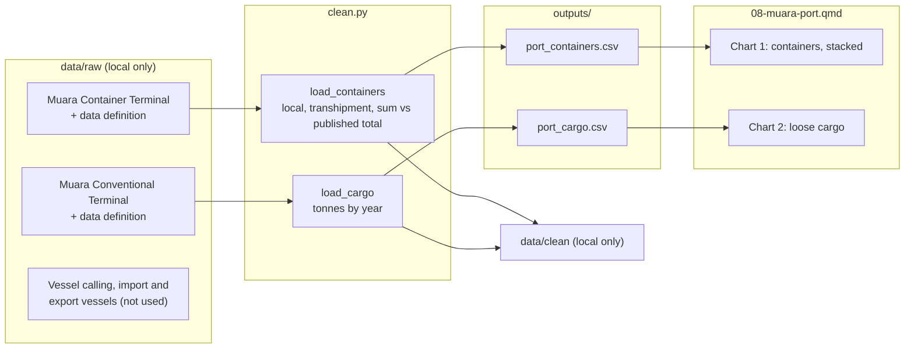

# 08 — Process record: Muara Port, 2004–2015

How the data for this study was worked on, from download to published page, and why each
choice was made. Follows [docs/WORKFLOW.md](../../docs/WORKFLOW.md). Repo only, not on the site.

**Status:** published 17 Oct 2026 · **Last updated:** 17 Oct 2026

## Data lineage



## 1. Acquire

| Dataset | Owner (as listed) | Edition | Files | Downloaded |
|---|---|---|---|---|
| MUARA CONTAINER TERMINAL, MUARA PORT 2004-2015 | Berthing Section and Statistic Unit, Ports Department | 2015 | table + `2.1-DATA-DEFINITION-…` | 17 Oct 2026 |
| MUARA CONVENTIONAL TERMINAL, MUARA PORT 2004-2015 | same | 2015 | table + `1.1-DATA-DEFINITION-…` | 17 Oct 2026 |
| VESSEL CALLING / IMPORT VESSELS / EXPORT VESSELS (2004–2015) | same | 2015 | tables + definitions | 17 Oct 2026 |

Logged in `DATA_SOURCES.md`. Terms of Use re-checked on 17 Oct 2026 (before case study 07).

## 2. Inspect

- **Shape:** one row per year, 2004–2015, with blank spacer columns.
- **Columns:** containers in TEU (local, transhipment, total); loose cargo in tonnes.
- **Definitions:** the data definition files define TEU (20' = 1, 40' = 2), local (bound for or
  from Brunei), transhipment (transiting at the container terminal only), total (local +
  transhipment) and uncontainerised cargo (steel, pipes, livestock, vehicles, cement…).
- **Known issues:** DATA_SOURCES.md, "Muara Port tables" (issues 1–5).

## 3. Clean

| # | Step | How (code) | Why |
|---|---|---|---|
| 1 | Keep Year and the named columns; trim names | `clean.py:_read` | Spacer columns and trailing spaces in headers |
| 2 | Check years unique and consecutive | `clean.py:_read` | A missing or doubled year would distort the chart |
| 3 | Compute local + transhipment and the gap to the published total | `clean.py:load_containers` | The definition says total = sum, but the published totals differ |

Values flagged rather than removed: half TEUs (kept, noted), the 2015 cargo jump (kept, noted).

## 4. Validate

| Check | Rule | Result |
|---|---|---|
| Schema | pandera: unique years, non-negative TEU, share 0–100, cargo > 0 | Pass |
| Totals | published total vs local + transhipment within 2.5% | Pass (max 2.4%) |
| Same years | both terminal tables cover the same years | Pass |
| Page claims | `assert` statements in the page | Pass |
| Unit tests | `tests/test_case08_clean.py` | Pass |

## 5. Process

| Output | Built from | Calculation | Why |
|---|---|---|---|
| `outputs/port_containers.csv` | container table | sum, gap, transhipment share | Chart 1; the gap stays visible |
| `outputs/port_cargo.csv` | conventional table | change on previous year | Chart 2 and the text |

## 6. Visualise

| Chart | Output | Type | Why |
|---|---|---|---|
| 1 | port_containers | stacked bars (local teal, transhipment violet) | Parts of a whole over time; shows the mix changing while the total stays similar |
| 2 | port_cargo | bars, one series | One measure per year in different units (tonnes), so its own chart, not a second axis |

Phones: same charts (bars fit at narrow widths).

## 7. Post-process

- [x] Small counts: not applicable (cargo quantities; TEU and tonnes columns marked as not counts)
- [x] Full cleaned tables saved locally: port_containers, port_cargo
- [x] Source + retrieval date on every chart; APA references in method
- [x] Disclaimer and AI-assistance byline
- [x] Neutral wording checked (cause-and-effect search: only "what caused" in the side note)
- [x] Context sources: none
- [x] Data period on title and cards
- [x] Glossary terms (new, publisher definitions): teu, local-containers, transhipment-containers, uncontainerised-cargo
- [x] Item status: not applicable
- [x] Translations: not enabled
- [x] Phone and desktop screenshots checked
- [x] `uv run pytest` passes

## Decision log

| Date | Decision | Options considered | Reason |
|---|---|---|---|
| 17 Oct 2026 | Two terminals only; vessel tables left out | Add vessel calls or vessel types | Agreed scope; the vessel tables cover different ports and can't be matched with each other |
| 17 Oct 2026 | Chart the published parts, report the published total beside them | Use the published total | The definition says total = sum; showing both keeps the gap visible rather than hiding it |
| 17 Oct 2026 | Related: 08 → 07 (same topic) | none | Both about trade in goods |
| 17 Oct 2026 | No context sources | Reported reasons for the fall in transhipment | What changed, not why; could be added later as reported background only |

## Reproduce

```sh
uv run python case_studies/08_muara_port/analysis/build.py
uv run quarto preview dashboard
```
