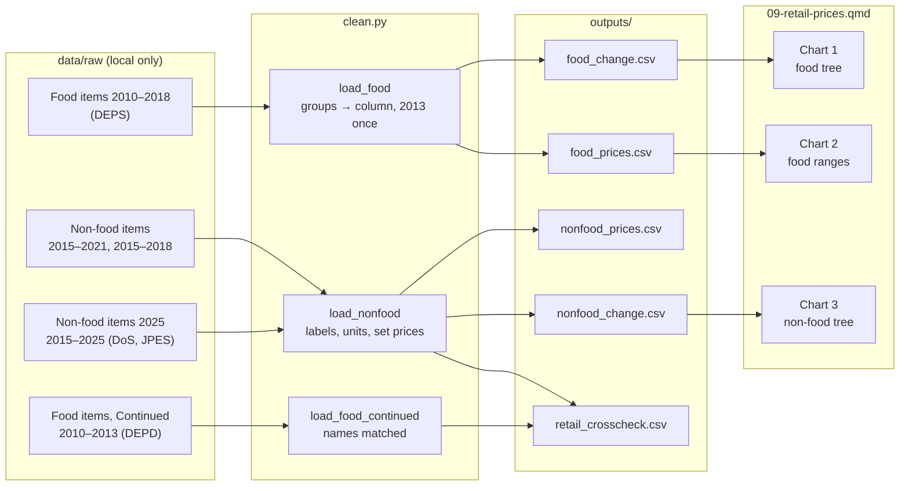

# 09 — Process record: Retail prices of selected food and non-food items

How the data for this study was worked on, from download to published page, and why each
choice was made. Follows [docs/WORKFLOW.md](../../docs/WORKFLOW.md). Repo only, not on the site.

**Status:** built 19 Oct 2026 · **Last updated:** 19 Oct 2026

## Data lineage



## 1. Acquire

| Dataset | Owner (as listed) | Edition | File | Downloaded |
|---|---|---|---|---|
| Average Retail Price Of Selected Food Items | Department of Economic Planning and Statistics | 2025 | `Average-Retail-Price-of-Selected-Food-Item.xlsx` | 19 Oct 2026 |
| Average Retail Price Of Selected Food Items (Continued) | Department of Economic Planning and Development | 2025 | `7-Average-Retail-Price-Of-Selected-Food-Items-Continued.xlsx` | 19 Oct 2026 |
| Average Retail Price of Selected Non-Food Items 2025 | Department of Statistics, JPES | 2025 | `Average-Retail-Price-of-Selected-Non-Food-Items-2025.xlsx` | 19 Oct 2026 |
| Average Retail Price of Selected Non-Food Items (variant `dos-jpes`) | Department of Statistics, JPES | 2025 | `Average-Retail-Price-of-Selected-Non-Food-Items.xlsx` | 19 Oct 2026 |
| Average Retail Price of Selected Non-Food Items (variant `deps`) | Department of Economic Planning and Statistics | 2025 | `Average-Retail-Price-of-Selected-Non-Food-Items-1.xlsx` | 19 Oct 2026 |

Logged in `DATA_SOURCES.md`. Found from the portal sitemap and search (pages 1–3, 19 Oct
2026); no food edition after 2018 exists. Terms of Use unchanged since 14 Oct 2026.

## 2. Inspect

- **Shape:** long, three columns (Year, item, price), one sheet; group header rows mixed in.
- **Columns:** the food file heads its price column "BND Million"; values are B$ prices.
- **Coverage:** food 2010–2018, 31 rows a year (5 group rows, 26 items, of which rice and bread
  are "-" every year); non-food 2015–2025, 2 group rows and 11 items.
- **Quirks:** 2013 listed twice in the food file (second listing kept); trailing spaces; units
  in group names for food per-kg items and in item names otherwise; "Margerine" as published;
  "Sawi Putih" in the Continued edition is Pak Choy in the main one.
- **Known issues:** DATA_SOURCES.md, "Average retail price tables, food and non-food".

## 3. Clean

| # | Step | How (code) | Why |
|---|---|---|---|
| 1 | Read three columns, trim names, "-" → missing | `clean.py:_read` | "-" means no price published, not zero |
| 2 | Group header rows → `group` column; header value checked against the items' sum, then dropped | `clean.py:_split_groups`, `build.py` | The header values add per-kg, per-tin and per-tray prices: no meaning |
| 3 | Keep the second listing of a year listed twice | `clean.py:load_food`, `duplicate_year_differences` | The two 2013 lists differ only for salted anchovies (B$11.81 vs B$11.80); the Continued edition has B$11.80 |
| 4 | Short sentence-case labels and units from names | `clean.py:UNIT_IN_NAME`, `build.py:DISPLAY` | Readable charts; the published name stays in `item` |
| 5 | Mark Government-set prices | `clean.py:SET_PRICES` | Tariff notes on the page; the table doesn't label them |
| 6 | Flag items with identical prices in 2010–2012 | `clean.py:repeated_years` | 18 of 24: likely carried forward |

Values flagged rather than removed: 2010–2012 food prices (`repeated_2010_2012`), kept in the
outputs and the data tables.

## 4. Validate

| Check | Rule | Result |
|---|---|---|
| Schema | pandera `PRICES`: prices > 0, one row per year and item | pass |
| Group rows | equal the sum of their items (food; non-food DEPS edition) | pass: all, so dropped as meaningless |
| Items without prices | exactly rice and bread | pass |
| Cross-check, food | Continued edition, 2010–2013, 52 values | 4 differ, at most B$0.04 (rounding) |
| Cross-check, non-food | JPES 2015–2021 (77 values) and DEPS 2015–2018 (44) | identical |
| Unit tests | `tests/test_case09_clean.py` | pass |

## 5. Process

| Output | Built from | Calculation | Why |
|---|---|---|---|
| `outputs/food_prices.csv` | food | price, repeat flag, index (2013 = 100) | Chart 2 and the data tables |
| `outputs/food_change.csv` | food | change 2013→2018, % | Chart 1 |
| `outputs/nonfood_prices.csv` | non-food 2025 | prices, unit, set-price flag | Data tables |
| `outputs/nonfood_change.csv` | non-food 2025 | change 2015→2025, % | Chart 3 |
| `outputs/retail_crosscheck.csv` | other editions | values compared, differences | Method text |

## 6. Visualise

| Chart | Output used | Chart type | Why this form |
|---|---|---|---|
| 1 · Food tree | food_change | Hierarchy tree, group → item (static SVG, `shared.svg.tree`); diverging chip per item, signed change written | Prices in different units don't add up, so a sunburst or treemap would mislead; equal rows keep the published grouping visible |
| 2 · Food ranges | food_prices | Range bars, lowest to highest index 2013–2018, dot for 2018 (Plotly); two widest teal | Start-to-end change hides swings (garlic 80 to 132) |
| 3 · Non-food tree | nonfood_change | Same tree as chart 1 | Same grouping logic; shows that 10 of 11 didn't move |

Diverging steps: falls blue `#2a78d6`/`#a9c9f0`, little change grey `#f0efec` (under 0.5%),
rises red `#f2a9a8`/`#e34948`; 10% splits the steps. Blue and red are the dataviz reference
pair; lightness runs light to dark on each arm. Changes are shown to one decimal so the text
always agrees with the step (−9.9% sits in "Fell", not "10% or more"). Chips have an outline,
so the light steps show against the card.

## Context sources (optional)

None. The author asked for official tariff sources if any exist. Searched 19 Oct 2026 for the
electricity, water and passport fee schedules: only a commercial report, a journal article
and news items were found, no official page, so the tariff notes are data-only.

## 7. Post-process

- [x] Small counts: not applicable (prices only)
- [x] Full cleaned tables saved locally with `write_clean`: food_prices, nonfood_prices
- [x] Source + retrieval date on every chart; APA references in method
- [x] Disclaimer and AI-assistance byline
- [x] Neutral wording checked (no causes)
- [x] Context sources: none
- [x] Data period on title and cards
- [x] Glossary terms marked: average-retail-price, set-price
- [x] Item status: not applicable (same items every year in the years compared)
- [x] Translations: not enabled
- [x] Phone and desktop screenshots checked
- [x] `uv run pytest` passes

## Decision log

| Date | Decision | Options considered | Reason |
|---|---|---|---|
| 19 Oct 2026 | Hierarchy tree, not sunburst or network | Sunburst, network diagram | Author agreed: prices don't add up, and items aren't linked (docs/CHART_TYPES.md) |
| 19 Oct 2026 | Food and non-food as separate sections | One combined period | Food ends 2018, non-food starts 2015: only 4 shared years |
| 19 Oct 2026 | Food base year 2013 | 2010 (full period) | Author chose 2013: 18 of 24 items repeat in 2010–2012; eggs flip from −18% to +11% with a 2010 base |
| 19 Oct 2026 | Subsidised items linked to 01, not reused | Include them | Author's choice |
| 19 Oct 2026 | Tariff notes data-only | Official context sources | Author asked for official sources if any; none found |
| 19 Oct 2026 | Keep 2013's second listing | First listing; average | Matches the Continued edition; differs by B$0.01 |

## Reproduce

```sh
uv run python case_studies/09_retail_prices/analysis/build.py
uv run quarto preview dashboard
```
