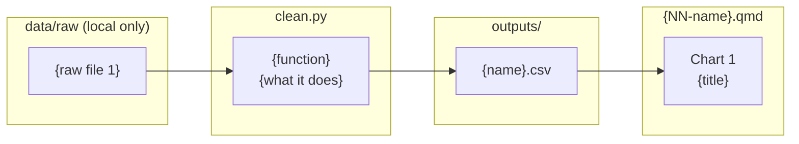

# {NN} — Process record: {Case study title}

How the data for this study was worked on, from download to published page, and why each
choice was made. Follows [docs/WORKFLOW.md](../../docs/WORKFLOW.md). Repo only, not on the site.

**Status:** {in progress / published {date}} · **Last updated:** {date}

## Data lineage



## 1. Acquire

| Dataset | Owner (as listed) | Edition | File | Downloaded |
|---|---|---|---|---|
| | | | | |

Logged in `DATA_SOURCES.md`. Terms of Use re-checked on {date}.

## 2. Inspect

What the raw file looks like before anything is changed.

- **Shape:** {rows × columns, wide/long, one sheet or several}
- **Columns:** {as published, with what they actually hold}
- **Coverage:** {years, districts, categories}
- **Quirks:** {merged headers, footnotes, units, spelling, blank rows}
- **Known issues:** {link to DATA_SOURCES.md entry, or "none found"}

## 3. Clean

| # | Step | How (code) | Why |
|---|---|---|---|
| 1 | | `clean.py:{function}` | |

Values flagged rather than removed: {list, or "none"}.

## 4. Validate

| Check | Rule | Result |
|---|---|---|
| Schema | {pandera: types, ranges, unique keys} | |
| Cross-check | {second table or approved source} | |
| Unit tests | `tests/test_case{NN}_*.py` | |

## 5. Process

| Output | Built from | Calculation | Why |
|---|---|---|---|
| `outputs/{name}.csv` | | | |

## 6. Visualise

| Chart | Output used | Chart type | Why this form |
|---|---|---|---|
| 1 | | | |

## Context sources (optional)

| Key | Source | Tier | Supports | Checked how |
|---|---|---|---|---|
| | | | | |

Listed in `context.yml` and logged in `CONTEXT_SOURCES.md` (policy §7). Background only.

## 7. Post-process

- [ ] Small counts (1 to 5) merged or suppressed, count columns in `tests/test_privacy.py`: {where, or "not applicable: national totals only"}
- [ ] Source + retrieval date on every chart; APA references in method
- [ ] Disclaimer and AI-assistance byline
- [ ] Neutral wording checked
- [ ] Context sources: in their own callout, reported not concluded (or "none")
- [ ] Data period on title and cards
- [ ] Glossary terms marked (list): {keys, or "none"}
- [ ] Item status shown where items change between years: {where, or "not applicable"}
- [ ] Translations: {not enabled / Malay / Chinese}
- [ ] Phone and desktop screenshots checked
- [ ] `uv run pytest` passes

## Decision log

| Date | Decision | Options considered | Reason |
|---|---|---|---|
| | | | |

## Reproduce

```sh
uv run python case_studies/{NN_name}/analysis/build.py
uv run quarto preview dashboard
```
