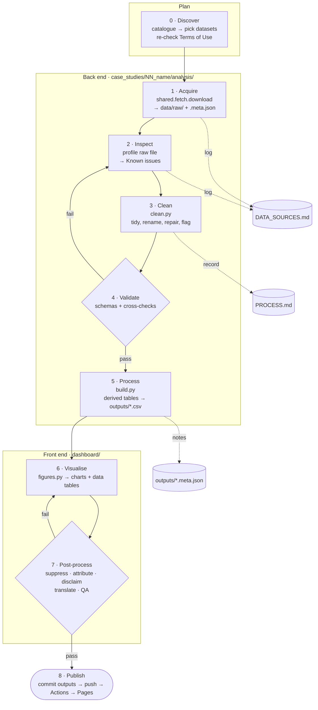

# Case study workflow

How every case study goes from a dataset on data.gov.bn to a published page. This is the
standard pipeline; each study records how it followed it in its own
`case_studies/NN_name/PROCESS.md` (repo only, not on the site).

Rules referred to below are in [DATA_USE_POLICY.md](../DATA_USE_POLICY.md) §4 (SOP).

## Pipeline

The diamonds are gates: work doesn't move on until the checks pass. A failed validation goes
back to inspection (we misunderstood the data), not forward with a workaround.

## Stages

| # | Stage | Input → output | Where | Gate / record |
|---|---|---|---|---|
| 0 | Discover | catalogue → chosen datasets and one question | `catalogue/datagovbn_catalogue.csv` | Terms page re-checked (SOP 1). Question written in README |
| 1 | Acquire | dataset URL → raw file + `.meta.json` | `shared.fetch.download` in `build.py` | Logged in `DATA_SOURCES.md` with download date (SOP 2). Raw stays local (SOP 3) |
| 2 | Inspect | raw file → notes on its shape and quirks | PROCESS.md §2 | Problems go into DATA_SOURCES.md "Known issues" **before** any fix |
| 3 | Clean | raw → tidy long table (one row per observation) | `analysis/clean.py` | Every step has a *why* in PROCESS.md §3. Doubtful values are flagged, not silently dropped |
| 4 | Validate | tidy table → pass / fail | pandera schemas in `build.py`, unit tests in `tests/` | Ranges, uniqueness, totals, cross-check with a second table or approved source |
| 5 | Process | tidy table → small derived CSVs | `analysis/build.py` → `outputs/` | `write_output(notes=…)` states what changed (SOP 4). Only `outputs/` reaches CI |
| 6b | Context (optional) | news, journals, official sources → "What was reported at the time" | `case_studies/NN/context.yml`, `CONTEXT_SOURCES.md` | Policy §7: opened and checked, archived if news, no numbers charted, no individuals named |
| 6 | Visualise | outputs → charts, each with its data table | `analysis/figures.py`, `shared/charts.py` | One message per chart. Data period in every title |
| 7 | Post-process | page → publishable page | `dashboard/case-studies/NN-name.qmd` | Checklist below |
| 8 | Publish | commit → live site | GitHub Actions | `uv run pytest` passes; the author pushes from their own terminal |

## Stage 7 checklist

- [ ] Counts below 5 suppressed or merged in any cross-tab (SOP 7, PDPO 2025)
- [ ] Every chart has the source + retrieval date line; APA references in the method section (SOP 5)
- [ ] "Not an official publication" disclaimer and AI-assistance byline (SOP 6, 10)
- [ ] Neutral wording: what changed and when, not judgements on performance (SOP 8)
- [ ] Context sources (if any): in their own callout, reported not concluded, logged in `CONTEXT_SOURCES.md` (policy §7)
- [ ] Data year/period on the title and every card
- [ ] Translations (when enabled): labels from the shared dictionary; English is the reference version
- [ ] Screenshot check on phone and desktop widths (headless Firefox)
- [ ] `uv run pytest` passes (page structure, provenance, site build)

## What goes where

| Document | Audience | Content |
|---|---|---|
| `README.md` (per study) | repo readers | question, sources, short method, findings, limitations |
| `PROCESS.md` (per study) | author / reviewers | full record of stages 1–7: what was done, how, and **why**; decision log |
| `DATA_SOURCES.md` | compliance | every download and known issue in source data |
| `CONTEXT_SOURCES.md` | compliance | every news, journal or official source cited for background, and how it was checked |
| `outputs/*.meta.json` | machines + site | provenance and change notes carried into the page |
| `dashboard/case-studies/*.qmd` | site visitors | the story; method summarised, not the full process |

`PROCESS.md` lives outside `dashboard/`, so Quarto never renders it. GitHub renders its
Mermaid diagrams directly.
